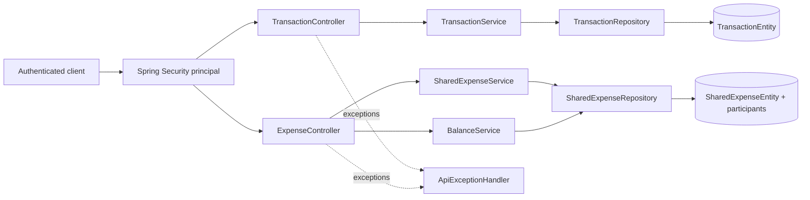

# Architecture
1. Transaction and Expense are separate Spring modules sharing authenticated principal IDs and the same JPA database.
2. Transactions are private to their owner; expenses store their creator, split type, and participant shares.
3. Controllers validate request DTOs, derive identity from Spring Security, and delegate business rules.
4. Services enforce ownership and financial invariants; repositories provide typed JPA persistence.
5. No controller or service uses raw SQL or exposes JPA entities as API responses.
6. Expense creation stores the total and ordered shares atomically in one service transaction.
7. BalanceService reads expenses involving the caller and nets debts in both directions for each counterparty.
8. A positive `netAmount` means the caller owes; a negative value means the counterparty owes the caller.
9. Jakarta Validation checks request shape; services enforce cross-field business constraints.
10. Shared exception handling returns explicit 400/404 responses without leaking inaccessible transaction IDs.
11. BigDecimal prevents binary floating-point drift; remaining equal-split cents go in participant order.
12. Owner-scoped repositories prevent clients from selecting another user's transaction owner.
13. These boundaries make financial rules testable and auditable; production still needs managed identity and persistence.

## Architecture and request-flow diagram

Create expense flow: authenticated request -> validated DTO -> service validates participants and calculates shares -> repository persists expense and participants -> response DTO. Balance flow: authenticated user -> service loads only expenses involving that user -> debt directions are aggregated and netted per counterparty -> response DTO.

See [TEST_CASES.md](TEST_CASES.md) for test scenarios and how to run them.
